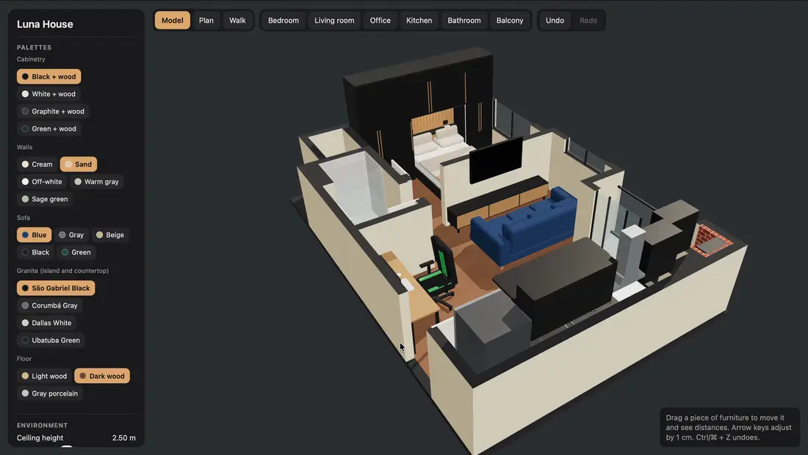
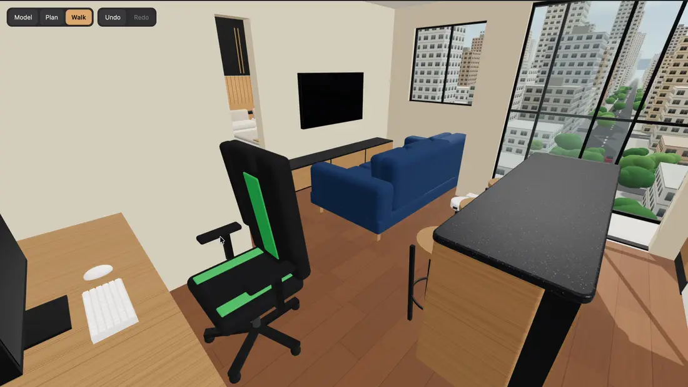

# Luna House

A personal project for decorating an apartment and seeing its floor plan at real size. It is an interactive 3D model of the apartment, drawn in centimeters from the dimensions on the builder's plan, so furniture can be placed and measured before it is bought.

Built with [Claude](https://claude.com/claude-code) (Claude Code), React and three.js.



## Features

- **Three view modes:** Model (orbit around a 3D cutaway), Plan (top-down) and Walk (first person: W A S D to move, mouse to look, Shift to speed up, Esc to exit).
- **Room shortcuts:** jump the camera to the bedroom, living room, office, kitchen, bathroom or balcony.
- **Movable furniture:** drag a piece to move it and see the distances around it. Arrow keys adjust by 1 cm and R rotates by 90°. The app warns about tight passages and collisions.
- **Undo and redo:** Ctrl/⌘ + Z and Ctrl/⌘ + Shift + Z.
- **Palettes:** cabinetry, walls, sofa, granite and floor.
- **Environment controls:** ceiling height, wall cut height, wardrobe LED, open doors and room names on the plan.
- **Day and night:** press N or use the Night checkbox.
- **City outside the windows:** a procedurally generated landscape, shown in Walk mode.
- **Saved locally:** settings and furniture positions are kept in the browser's `localStorage`.



## Stack

React 19, three.js, TypeScript and Vite.

## Running it

```sh
npm install
npm run dev
```

`npm run dev` starts the Vite dev server and opens the app in the browser.

Other scripts:

- `npm run typecheck` checks the types.
- `npm run build` checks the types and builds a single self-contained file, `dist/index.html`, which opens with a double click (no server needed).
